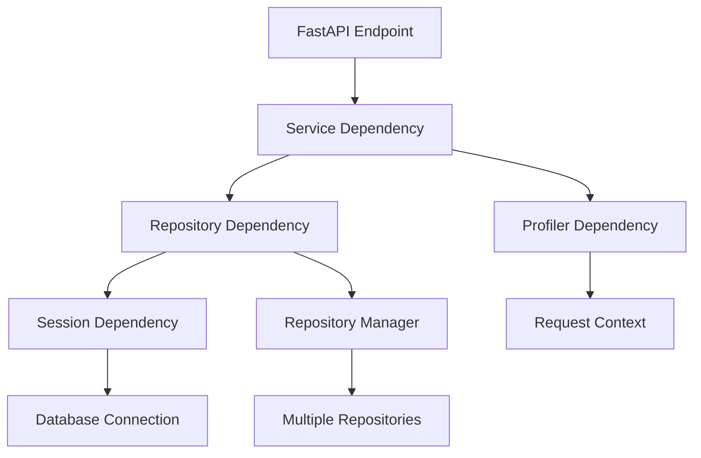
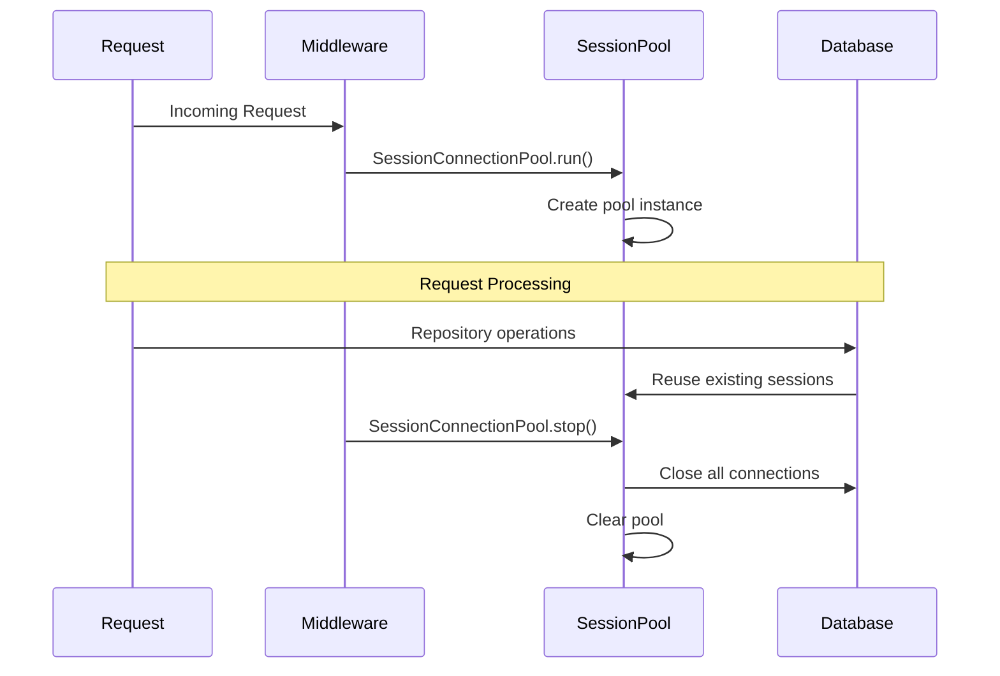

# Architecture Guide

FastStack is built on a sophisticated multi-layer architecture that combines modern Python patterns with enterprise-level design principles. This guide explains the framework's internal architecture and how components work together.

## Overview

```
┌─────────────────┐    ┌─────────────────┐    ┌─────────────────┐
│   API Layer    │    │  Service Layer  │    │Repository Layer │
│   (FastAPI)    │───▶│ (Business Logic)│───▶│ (Data Access)   │
└─────────────────┘    └─────────────────┘    └─────────────────┘
         │                       │                       │
         ▼                       ▼                       ▼
┌─────────────────────────────────────────────────────────────────┐
│                    Cross-Cutting Concerns                      │
├─────────────────┬─────────────────┬─────────────────┬──────────┤
│  Dependencies   │   Context Pool  │   Cache System  │Database  │
│   (DI Magic)    │  (State Mgmt)   │ (Performance)   │(Sessions)│
└─────────────────┴─────────────────┴─────────────────┴──────────┘
```

## Core Components

### 1. Dependency Injection System

The heart of FastStack is its sophisticated dependency injection system that generates functions at runtime.

#### Dynamic Function Generation

```python
# Multi-database session registration:
def register_sessions(sessions: List[Tuple[Type[Session], DBConfig]]):
    for session_cls, config in sessions:
        get_db_method_name = f"get_{session_cls.__name__.lower()}_db"

        def generic_db_method():
            try:
                db_session, pool, token = _load_db(session_cls)
                yield db_session
            finally:
                _close_db(db_session, token, pool)

        # MAGIC: Creates function dynamically and adds to module
        setattr(current_module, get_db_method_name, generic_db_method)
        DB_MAPPING[session_cls] = generic_db_method
```

**Multi-Database Example:**
```python
# This registration:
register_sessions([
    (SessionApp, app_db_config),
    (SessionAnalytics, analytics_db_config),
])

# Automatically creates:
# - get_sessionapp_db() → for main application database
# - get_sessionanalytics_db() → for analytics database
# - Both available for FastAPI Depends() and Repository Manager injection
```

**What this means:**
- Each database gets its own session type and connection pool
- Repository Managers are automatically bound to correct database sessions
- Type safety ensures repositories only access their designated database

#### Type Introspection

FastStack automatically extracts generic type parameters:

```python
# Your repository
class UserRepository(BaseRepository[User]):
    def __init__(self, db: Session, profiler: Profiler):
        super().__init__(db, profiler)

# Framework extracts "User" automatically
def get_model(self) -> Type[T]:
    return self.__class__.__orig_bases__[0].__args__[0]
```

#### Dependency Resolution Flow



### 2. Context Pool Management

FastStack introduces a revolutionary approach to managing Python's ContextVar system.

#### ContextVar Centralization

```python
class CtxPool:
    def __init__(self):
        # Central registry: name -> (ContextVar, persistent_flag)
        self._vars: dict[str, tuple[ContextVar, bool]] = {}

    def new(self, name: str, default: Any = None, persistent: bool = False):
        var = ContextVar(name, default=default)
        self._vars[name] = (var, persistent)
        return var
```

#### Request Lifecycle Integration

```python
# Middleware sets request context
ctxpool.set("request_context", request)

# Services access via context pool
request = ctxpool.get("request_context")

# Automatic cleanup (only non-persistent)
ctxpool.clear()  # Called after request
```

#### Context Hierarchy

```
Request Context Pool
├── request_context (temporary)
├── session_connection_pool (temporary)
├── profiler_ctx (temporary)
├── repo_cache (temporary)
└── app_config (persistent)
```

### 3. Multi-Layer Repository Architecture

FastStack provides three levels of data access, each with specific use cases.

#### Architecture Layers

```python
# Level 1: Raw SQL with security
class AbstractRepository(ABC):
    def fetch_paginated(self, query: str, pagination: PaginationParams):
        self._only_select_validation(query)  # Security first
        # Execute raw SQL with automatic pagination

# Level 2: ORM with business logic
class BaseRepository(AbstractRepository, Generic[T]):
    def get_by_id(self, instance_id: int) -> T | None:
        if issubclass(self.model, SoftDeleteMixin):
            # Automatic soft delete filtering
        return self.db.query(self.model).filter(...).one_or_none()

# Level 3: External database abstraction
class ExternalBaseRepository(AbstractRepository):
    # For connecting to external systems (DWH, Analytics, etc.)
```

#### Repository Manager Pattern (Per-Database)

FastStack supports multiple Repository Managers, each bound to a specific database session:

```python
class RepositoryManager(Generic[SESSION_T]):
    def __init__(self, db: SESSION_T):
        self.db = db  # Specific database session (e.g., SessionApp, SessionAnalytics)
        self._repositories: Dict[Type[AbstractRepository], AbstractRepository] = {}

    def get(self, repository_class: Type[REPO_T]) -> REPO_T:
        # Lazy loading with per-database caching
        if repository_class not in self._repositories:
            self._repositories[repository_class] = self._load_repository_instance(repository_class)
        return self._repositories[repository_class]
```

**Multi-Database Usage:**
```python
# Define separate Repository Managers for each database
class AppRepositoryManager(RepositoryManager[SessionApp]):
    """Manages repositories for main application database"""
    pass

class AnalyticsRepositoryManager(RepositoryManager[SessionAnalytics]):
    """Manages repositories for analytics database"""
    pass

# Service can access multiple databases
class MyService(BaseService):
    def __init__(self,
        app_rm: AppRepositoryManager = repository_manager_dep(AppRepositoryManager),
        analytics_rm: AnalyticsRepositoryManager = repository_manager_dep(AnalyticsRepositoryManager)
    ):
        self.app_rm = app_rm          # Access to main DB repositories
        self.analytics_rm = analytics_rm  # Access to analytics DB repositories

    def cross_database_operation(self):
        user_repo = self.app_rm.get(UserRepository)        # Main DB
        events_repo = self.analytics_rm.get(EventRepository) # Analytics DB

        user = user_repo.get_by_id(1)
        events_repo.log_user_action(user.id, "profile_view")
```

**Key Benefits:**
- **Database Isolation**: Each Repository Manager only accesses its designated database
- **Type Safety**: Compile-time verification that repositories match their database
- **Resource Management**: Separate connection pools and sessions per database
- **Cross-Database Operations**: Services can orchestrate operations across multiple databases

#### Database Roles & Migration Strategy

FastStack follows the **"One Primary, Multiple Secondary"** database pattern:

**Primary Database (Alembic-Managed):**
```python
class SessionApp(Session):
    """Main application database - Alembic migrations apply here"""
    pass

class AppRepositoryManager(RepositoryManager[SessionApp]):
    """Manages repositories for main business logic"""
    pass

# Alembic configuration targets ONLY the primary database
# alembic/env.py:
target_metadata = MainAppBase.metadata  # Only SessionApp models
sqlalchemy.url = settings.APP_DB_CONFIG.connection_string
```

**Secondary Databases (Non-Alembic):**
```python
class SessionAnalytics(Session):
    """Analytics database - NO Alembic migrations"""
    pass

class SessionDwh(Session):
    """Data warehouse - separate schema management"""
    pass

# These databases manage their own schemas:
# - Analytics: Time-series tables, event logging
# - DWH: Aggregate tables, reporting views
# - External: Read-only connections to legacy systems
```

**Model Organization:**
```
models/
├── main/          # Alembic-managed (Primary DB)
│   ├── user.py    # Has migrations
│   ├── post.py    # Has migrations
│   └── order.py   # Has migrations
├── analytics/     # Non-Alembic (Analytics DB)
│   ├── event.py   # Time-series, no migrations
│   └── metric.py  # Log tables, no migrations
└── dwh/          # Non-Alembic (Data Warehouse)
    ├── report.py  # Aggregate views
    └── stats.py   # Business intelligence
```

**Service Orchestration:**
```python
class OrderService(BaseService):
    def __init__(self,
        app_rm: AppRepositoryManager = repository_manager_dep(AppRepositoryManager),
        analytics_rm: AnalyticsRepositoryManager = repository_manager_dep(AnalyticsRepositoryManager)
    ):
        self.app_rm = app_rm        # Primary business logic
        self.analytics_rm = analytics_rm  # Event tracking

    def create_order(self, order_data: dict):
        # Primary database - transactional, Alembic-managed
        order_repo = self.app_rm.get(OrderRepository)
        order = order_repo.create(Order(**order_data))

        # Analytics database - event logging, no migrations
        event_repo = self.analytics_rm.get(EventRepository)
        event_repo.log_event("order_created", {
            "order_id": order.id,
            "user_id": order.user_id,
            "amount": order.total
        })

        return order
```

**Why This Pattern Works:**
- ✅ **Clear Migration Path**: Alembic only manages core business models
- ✅ **Performance Optimization**: Each database tuned for its specific workload
- ✅ **Operational Simplicity**: Different backup/monitoring strategies per database
- ✅ **Scalability**: Databases can be on separate servers with different hardware

### 4. Caching Architecture

FastStack implements a sophisticated caching system with enterprise-level features.

#### Multi-Encoder Support

```python
# JSON encoder for API responses
class CacheResponseEncoder:
    @staticmethod
    def encode(value: Any) -> str:
        if isinstance(value, BaseModel):
            return json.dumps(value.model_dump())

# Pickle encoder for complex objects
class PickledEncoder:
    @staticmethod
    def encode(value: Any) -> bytes:
        return pickle.dumps(value)
```

#### Built-in Stampede Protection

FastStack's `@cache_method_async` automatically prevents cache stampede:

```python
@cache_method_async(expire=300)
async def expensive_operation(self, param: str):
    # FastStack automatically:
    # 1. Generates cache key from method signature
    # 2. Uses Redis locks to prevent multiple concurrent computations
    # 3. Only one request computes the value, others wait
    # 4. All requests get the same cached result

    result = await compute_expensive_result(param)
    return result  # Cached automatically with stampede protection
```

#### Cache Key Generation

```python
def key_builder(func: Callable, namespace: str, args: Tuple, kwargs: Dict) -> str:
    # Remove 'self' from args for instance methods
    key_args = args[1:] if args and hasattr(args[0], "__class__") else args
    cache_key = f"{func.__module__}:{func.__name__}:{key_args}:{kwargs}"

    # Always hash for consistent key length
    return KeyBuilder.hash_key(f"{namespace}:{cache_key}")
```

### 5. Database Session Management

FastStack provides sophisticated session lifecycle management with connection pooling.

#### Session Connection Pool

```python
class SessionConnectionPool:
    def __init__(self):
        self.pool = {}  # session_class_name -> session_instance

    def add(self, session: SESSION_T):
        if self.get(session.__class__.__name__) is not None:
            raise ValueError("Session already exists in pool")
        self.pool[self._key_name(session)] = session
        self._refresh()  # Update context pool

    def clear(self):
        for session in self.pool.values():
            session.close()  # Proper cleanup
        self.pool.clear()
```

#### Request-Scoped Session Management



### 6. Celery Integration

FastStack provides advanced Celery integration with task deduplication and automatic fallbacks.

#### Task Deduplication System

```python
class BaseTask(Task):
    def apply_async(self, args=None, kwargs=None, **other_kwargs):
        # Generate unique task ID based on name + arguments
        task_key = BaseTask.generate_unique_task_id(self.name, args, kwargs)

        # Redis NX operation - atomic "set if not exists"
        if not self._cache_task_id(task_key):
            return {"status": "Task already exists. Skipping."}

        try:
            return super().apply_async(args, kwargs, **other_kwargs)
        except Exception:
            # Clean up on failure
            get_redis_client().delete(task_key)
            raise
```

#### Automatic Fallback Functions

```python
@task_failure.connect
def task_failure_handler(sender=None, exception=None, **kwargs):
    # Look for {task_name}__fallback function
    failed_method_suffix = "__fallback"
    task_name = sender.run.__name__
    failed_func_name = f"{task_name}{failed_method_suffix}"

    # Dynamic function discovery
    mod = importlib.import_module(sender.__module__)
    failed_func = getattr(mod, failed_func_name, None)

    if callable(failed_func):
        failed_func(*args, **kwargs)  # Execute fallback
```

## Request Lifecycle

Here's how a typical request flows through FastStack:

### 1. Request Initialization

```python
# Middleware (RequestMiddlewareASGI)
async def __call__(self, scope, receive, send):
    correlation_id = str(uuid.uuid4())

    # Create request context
    request = StarletteRequest(scope, receive)
    request.state.profiler = Profiler()

    # Store in context pool
    ctxpool.set("request_context", request)
```

### 2. Session Setup

```python
# Session Middleware (DBSessionMiddlewareASGI)
async def __call__(self, scope, receive, send):
    SessionConnectionPool.run()  # Initialize session pool
    try:
        await self.app(scope, receive, send)
    finally:
        await SessionConnectionPool.astop()  # Cleanup
        ctxpool.clear()  # Clear temporary context
```

### 3. Dependency Resolution

```python
# FastAPI resolves dependencies
async def get_user(
    user_id: int,
    user_service: UserService = service_dep(UserService)  # Magic happens here
):
    # service_dep triggers:
    # 1. Type introspection of UserService.__init__
    # 2. Resolution of UserRepository dependency
    # 3. Resolution of database session dependency
    # 4. Resolution of profiler dependency
    # 5. Instantiation with proper parameters
```

### 4. Business Logic Execution

```python
class UserService:
    def __init__(self, user_repo: UserRepository, profiler: Profiler):
        self.user_repo = user_repo
        self.profiler = profiler

    @cache_method(expire=300)
    def get_user_by_id(self, user_id: int) -> User:
        # Cache layer automatically handles:
        # 1. Cache key generation
        # 2. Redis lookup
        # 3. Stampedo protection
        # 4. Result caching
        return self.user_repo.get_by_id(user_id)
```

### 5. Response and Cleanup

```python
# Response sent to client
# Finally blocks execute:
# 1. Database sessions closed
# 2. Context variables cleared (non-persistent)
# 3. Profiler data logged
# 4. Memory cleanup
```

## Advanced Patterns

### 1. Multi-Database Applications

```python
# Define multiple session types
class PrimarySession(Session): pass
class AnalyticsSession(Session): pass
class CacheSession(AsyncSession): pass

# Register each with different configs
register_sessions([
    (PrimarySession, primary_db_config),
    (AnalyticsSession, analytics_db_config),
    (CacheSession, cache_db_config),
])

# Use in repositories
class UserRepository(BaseRepository[User]):
    def __init__(self, db: PrimarySession, profiler: Profiler):
        super().__init__(db, profiler)

class EventRepository(AbstractRepository):
    def __init__(self, db: AnalyticsSession, profiler: Profiler):
        super().__init__(db, profiler)
```

### 2. Context-Aware Services

```python
class NotificationService:
    def send_notification(self, user_id: int, message: str):
        # Access request context for correlation ID
        request = ctxpool.get("request_context")
        correlation_id = request.headers.get("X-Correlation-ID")

        # Use profiler from context
        profiler = ctxpool.get("request_context").state.profiler

        with profiler.profile("send_notification"):
            # Send notification with correlation context
```

### 3. Background Task Integration

```python
from faststack.celery.base_task import BaseTask

class ProcessUserTask(BaseTask):
    def run(self, user_id: int):
        # Access services outside FastAPI context
        user_service = load_service(UserService)
        return user_service.process_user(user_id)

# Automatic fallback
def process_user_task__fallback(user_id: int):
    logger.error(f"Failed to process user {user_id}")
    # Implement fallback logic
```

## Design Principles

### 1. Convention over Configuration

FastStack follows strong conventions to minimize configuration:
- Repository classes automatically get appropriate database sessions
- Service classes automatically get required repositories
- Cache keys are generated from function signatures
- Database session lifetimes follow request boundaries

### 2. Type Safety First

Every component is designed with type safety in mind:
- Generic repositories with automatic model extraction
- Type-safe dependency resolution
- Runtime type validation for configurations
- Full mypy compatibility

### 3. Performance by Default

Framework optimizations are built-in:
- Request-scoped caching of expensive objects
- Connection pooling and reuse
- Lazy loading of dependencies
- Efficient context variable management

### 4. Enterprise Readiness

Production concerns are handled automatically:
- Automatic resource cleanup
- Error recovery patterns
- Monitoring and profiling integration
- Scalable background task processing

## Next Steps

- **[Dependency Injection Guide](dependency-injection.md)** - Deep dive into the DI system
- **[Repository Patterns](repositories.md)** - Advanced data access patterns
- **[Caching Strategies](caching.md)** - Performance optimization techniques
- **[Performance Tuning](performance.md)** - Production optimization guide